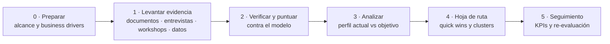

# Test Process Assessment

**Un método práctico para evaluar la madurez del proceso de pruebas con TMMi y TPI NEXT, y convertir los hallazgos en una hoja de ruta de mejora orientada al negocio.**

[English](README.md) · Español

---

## Para qué sirve

Antes de invertir en pruebas, quienes lideran calidad suelen hacerse tres preguntas:

- *¿Dónde estamos realmente?* No lo que dice el procedimiento, sino lo que los equipos hacen cada día.
- *¿Qué arreglamos primero?* Con presupuesto limitado, ¿qué mejoras va a notar el negocio?
- *¿Cómo sabremos que funcionó?* ¿Qué señales mostrarán avance en seis o doce meses?

Este repositorio reúne el método, las guías y las plantillas que uso para responderlas. Es genérico a propósito: **no contiene datos de clientes** y **no reproduce los checkpoints** de ninguno de los modelos, que pertenecen a sus dueños.

## El método en una mirada

| Fase | Pregunta clave | Resultado principal |
|---|---|---|
| 0 · Preparar | ¿Para qué quiere el negocio mejores pruebas? | Business drivers, alcance, mapa de actores, plan |
| 1 · Levantar evidencia | ¿Qué pasa hoy? | Matriz de evidencia con al menos tres fuentes |
| 2 · Verificar y puntuar | ¿Qué tan madura está cada área? | Perfil de madurez con nivel de confianza por área |
| 3 · Analizar | ¿Dónde está la brecha que importa? | Perfil objetivo derivado de los business drivers |
| 4 · Hoja de ruta | ¿Qué hacemos primero? | Quick wins, clusters priorizados, responsables y fechas |
| 5 · Seguimiento | ¿Está funcionando? | Tablero de KPIs y plan de re-evaluación |

Descripción completa (en inglés): [docs/method.md](docs/method.md).

## Principios con los que trabajo

1. **Primero los business drivers.** El nivel objetivo sale de lo que necesita el negocio, no de subir de nivel por subir.
2. **Triangular la evidencia.** Cada hallazgo se respalda con al menos dos fuentes: documentos, entrevistas, workshops o datos de herramientas.
3. **Describir la práctica, no el procedimiento.** En los workshops se pregunta cómo se trabaja hoy; el mapeo a checkpoints lo hace después el equipo evaluador.
4. **Seguridad psicológica.** Regla de Chatham House, sin jefaturas directas en las sesiones operativas, y aquí no se evalúa a personas.
5. **Pasos pequeños que la gente pueda asumir.** Toda hoja de ruta incluye quick wins que los equipos pueden empezar sin presupuesto ni permiso.

## Qué modelo elegir

| | TMMi | TPI NEXT |
|---|---|---|
| Estructura | Escalonado: 5 niveles, 16 áreas de proceso | Continuo: 16 áreas clave, 4 niveles cada una |
| Conviene cuando | Se busca una referencia escalonada reconocida o un assessment formal | Se quiere mejorar área por área, guiado por los business drivers |
| Orden de mejora | Nivel por nivel | Clusters de checkpoints, ordenados por prioridad de negocio |
| Cómo lo he usado | Diagnóstico de startups (investigación de Magíster) | Assessment de un área de calidad corporativa |

Detalle (en inglés): [docs/models.md](docs/models.md).

## Contenido

| Ruta | Qué es |
|---|---|
| [docs/method.md](docs/method.md) | Fases, actividades, roles, entradas y salidas, plan de ejemplo |
| [docs/models.md](docs/models.md) | Estructura de TMMi y TPI NEXT en breve, y cómo los combino |
| [templates/evidence-matrix.md](templates/evidence-matrix.md) | Cómo registrar y calificar evidencia (también en [CSV](templates/evidence-matrix.csv)) |
| [templates/interview-guide.md](templates/interview-guide.md) | Preguntas de entrevista por rol |
| [templates/report-outline.md](templates/report-outline.md) | Estructura del informe, convenciones de puntuación y formato de hoja de ruta |
| [Diseño de workshops](https://github.com/ckachury/liberating-structures-for-quality/blob/main/sessions/test-process-assessment-workshops.md) | Cuatro workshops de levantamiento con Estructuras Liberadoras |

Los documentos detallados están en inglés; este README resume su contenido.

## Trabajo relacionado

- [lean-quality-framework](https://github.com/ckachury/lean-quality-framework): diagnóstico TMMi de 10 startups tecnológicas y el framework de calidad lean que construí a partir de él.
- [liberating-structures-for-quality](https://github.com/ckachury/liberating-structures-for-quality): diseños de facilitación que uso en los assessments.

## Notas

TMMi® es marca registrada de TMMi Foundation. TPI® NEXT es un modelo de Sogeti. Este repositorio describe cómo los aplico y no reemplaza las publicaciones oficiales. Contenido compartido bajo [CC BY 4.0](LICENSE).

---

Carla Achury · Calidad y Gobierno de IA · Santiago, Chile · [ckachury.github.io](https://ckachury.github.io)
