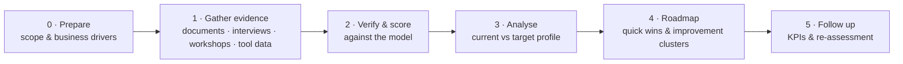

# Test Process Assessment

**A practical method for assessing test process maturity with TMMi and TPI NEXT, and turning the findings into a business-driven improvement roadmap.**

English · [Español](README.es.md)

---

## Why this exists

Quality leaders usually ask three questions before investing in testing:

- *Where are we really?* Not what the procedure says, but what teams do every day.
- *What should we fix first?* With limited budget, which improvements will the business actually feel?
- *How will we know it worked?* Which signals show progress six or twelve months from now?

This repository contains the method, guides and templates I use to answer those questions. It is generic by design: it holds **no client data**, and it does **not reproduce the checkpoints** of either model, which belong to their owners.

## The method at a glance

| Phase | Key question | Main output |
|---|---|---|
| 0 · Prepare | Why does the business want better testing? | Business drivers, scope, stakeholder map, plan |
| 1 · Gather evidence | What happens today? | Evidence matrix from at least three sources |
| 2 · Verify & score | How mature is each area? | Maturity profile with confidence level per area |
| 3 · Analyse | Where is the gap that matters? | Target profile derived from business drivers |
| 4 · Roadmap | What do we do first? | Quick wins, prioritised clusters, owners, dates |
| 5 · Follow up | Is it working? | KPI dashboard and re-assessment plan |

Full description: [docs/method.md](docs/method.md).

## Principles I work by

1. **Business drivers first.** The target maturity comes from what the business needs, not from reaching the next level for its own sake.
2. **Triangulate evidence.** Every finding is supported by at least two sources: document review, interviews, workshops or tool data.
3. **Describe practice, not procedure.** Workshops ask how work happens today; mapping to model checkpoints happens afterwards, done by the assessors.
4. **Psychological safety.** Chatham House rule, no direct managers in operational sessions, nobody is evaluated as a person.
5. **Small steps people can own.** Every roadmap includes quick wins teams can start without budget or permission.

## Choosing a model

| | TMMi | TPI NEXT |
|---|---|---|
| Structure | Staged: 5 maturity levels, 16 process areas | Continuous: 16 key areas, 4 maturity levels each |
| Best when | The organisation wants a recognised staged reference, or a formal assessment | The organisation wants to improve area by area, guided by business drivers |
| Improvement order | Level by level | Clusters of checkpoints, ordered by business priority |
| My use | Startup and scale-up diagnostics (Master's research) | Assessment of a corporate quality department |

Details: [docs/models.md](docs/models.md).

## Contents

| Path | What it is |
|---|---|
| [docs/method.md](docs/method.md) | Phases, activities, roles, inputs and outputs, sample plan |
| [docs/models.md](docs/models.md) | TMMi and TPI NEXT structure in brief, and how I combine them |
| [templates/evidence-matrix.md](templates/evidence-matrix.md) | How to record and rate evidence (also as [CSV](templates/evidence-matrix.csv)) |
| [templates/interview-guide.md](templates/interview-guide.md) | Interview questions by role |
| [templates/report-outline.md](templates/report-outline.md) | Assessment report structure, scoring conventions and roadmap format |
| [Workshop designs](https://github.com/ckachury/liberating-structures-for-quality/blob/HEAD/sessions/test-process-assessment-workshops.md) | Four evidence-gathering workshops built with Liberating Structures |

## Related work

- [lean-quality-framework](https://github.com/ckachury/lean-quality-framework): TMMi-based diagnosis of 10 tech startups and a lean quality framework built from it.
- [liberating-structures-for-quality](https://github.com/ckachury/liberating-structures-for-quality): facilitation designs used during assessments.

## Notes

TMMi® is a registered trademark of the TMMi Foundation. TPI® NEXT is a model by Sogeti. This repository describes how I apply them and does not replace the official publications. Content is shared under [CC BY-NC-ND 4.0](LICENSE). For commercial use or licensing, [contact me](https://www.linkedin.com/in/carla-achury-617b7536/).

---

Carla Achury · Quality & AI Governance · Santiago, Chile · [ckachury.github.io](https://ckachury.github.io)
